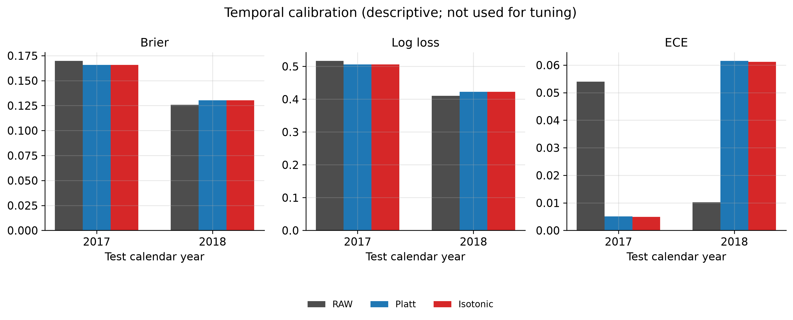

# Evidence-Separated Credit Scoring, Additive Explainability, and Shariah-Oriented Governance: A Research Prototype on a LendingClub Extract, with Independent UCI Methodology Context

| Item | Value |
| --- | --- |
| **Document ID** | `MANUSCRIPT-DRAFT-V1` |
| **Date** | 2026-09-16 |
| **Type** | Manuscript after integrity-gate prose narrowing; camera-ready preparation audit |
| **Evidence freeze** | Stages 2–10 closed; no new experiments |
| **Paired map** | `docs/paper/MANUSCRIPT_EVIDENCE_MAP.md` |

This file is an IEEE-style draft. Methodological accuracy is prioritized over polished prose. Numerical claims are transcribed from frozen repository artifacts. Where a requested quantity is absent from the authoritative stored artifact, the manuscript states that it is **not stored** and does not calculate it. Unverified literature-package metadata are not silently completed.

---

## 1. Title

**Evidence-Separated Credit Scoring, Additive Explainability, and Shariah-Oriented Governance: A Research Prototype on a LendingClub Extract, with Independent UCI Methodology Context**

The title does not describe the system as Shariah-compliant, certified, or production-ready.

---

## 2. Abstract

This study presents a research prototype for Shariah-oriented governance and evidence traceability in credit-risk decision mapping. Credit-risk scoring, additive explainability, and governance evidence are treated as separate objects and fused only at a final decision map. The prototype is not Shariah certification, a fatwa, an automated Shariah-compliance verdict, expert-validated Shariah decisioning, or a production credit engine. It reports no fraud-detection performance.

The revised manuscript objective, adopted at writing time and not prospectively registered, is to characterize predictive performance, additive explanation identity, documentary-evidence abstention, and decision-routing consequences of a modular research prototype using frozen artifacts. It does not establish greater transparency, institutional defensibility, or predictive superiority relative to a monolithic classifier. The primary executed dataset is a Zenodo LendingClub granting-model extract of originated-and-resolved loans (1,347,681 rows). Rejected applicants are absent, so the extract is not an applicant funnel. Stage 2 records this extract as US P2P 2007–2018, not an Islamic-finance contract sample. A chronological split by issue month yields TRAIN \(n=941{,}267\), VALIDATION \(n=197{,}528\), and TEST \(n=208{,}886\). Four LendingClub model families were evaluated once on TEST after a TRAIN+VALIDATION refit (context **M-4B**). The additive EBM was retained by a validation PR-AUC tie window plus a Brier/simplicity rule, not because it had the highest PR-AUC. LendingClub XGBoost has higher stored TEST ROC-AUC. Downstream probabilities come from a distinct **TRAIN-only** EBM with Platt scaling fitted on validation scores only (context **M-5**). Pooled M-5 raw and Platt ROC-AUC are both \(0.6776693941139847\); Platt Brier is \(0.15616920271522994\) and ECE is \(0.020267295489117824\). On the 2018 slice the same frozen Platt map worsens Brier, ECE, and log loss relative to raw. TEST was not used to fit or replace the calibrator.

Explainability uses an exact additive logit decomposition of the M-5 EBM on 5,000 rows. That identity is not a demonstrated human benefit. TreeSHAP was not used. The LendingClub extract does not contain contract-level Shariah fields and contains no expert-labeled Shariah benchmark. Dataset-level schema status is `INSUFFICIENT_SCHEMA_FOR_APPLICANT_DETERMINATION`. Per-application status under stored engine `stage7-shariah-engine-v1` is `INSUFFICIENT_INFORMATION` on all 208,886 TEST rows. The live scope-gated screen did not regenerate that result. Under the frozen G0 map, A0 yields 5,232 APPROVE / 203,627 HUMAN_REVIEW / 27 REJECT; A1 yields 0 / 208,859 / 27; A3/A4 yields 61,855 / 0 / 147,031. The 27 fused rejects are the HIGH credit band, not established Shariah violations. `HUMAN_REVIEW` is simulated routing, not a measured workload. Identical scores make predictive invariance true by construction.

An independent UCI Default of Credit Card Clients analysis (context **M-9.4-AE**) reports logistic regression and EBM TEST metrics as methodology context. It does not validate the LendingClub architecture or the governance layer. An execution-time UCI XGBoost analysis (context **M-9.4-X**) is exploratory and is not presented as the primary validated model or as proof of overall superiority. Stage 4B LendingClub XGBoost and Stage 9.4 UCI XGBoost are not merged.

**Index Terms**—See Keywords.

---

## 3. Keywords

credit risk; explainable boosting machine; probability calibration; additive SHAP; decision policy; Shariah-oriented governance; evidence traceability; LendingClub; temporal split.

Keywords deliberately omit “Shariah-compliant,” “certified,” and “fraud detection.”

---

### Table and figure plan (transcription only)

No new scientific figures requiring scoring, metric recomputation, calibration refit, or threshold search are generated in this draft. Proposed items reuse stored artifacts.

| ID | Caption intent | Source artifact | Computation in this draft |
| --- | --- | --- | --- |
| Table I | Executed datasets, roles, \(n\), hashes | Instantiated in §7.3 from `docs/PAPER_EVIDENCE_INVENTORY.md` §2; `audit/lendingclub_split_manifest.json`; `audit/uci_split_manifest.json` | None |
| Table II | Two LendingClub EBM identities (M-4B vs M-5) | Inventory §3; `results/metrics/stage4b_test_metrics.json`; `results/calibration/metrics/stage5_test_metrics.json` | None |
| Table III | M-4B LendingClub TEST family metrics | `results/metrics/stage4b_test_metrics.json` | None |
| Table IV | M-5 validation selection and TEST calibration | `results/calibration/metrics/stage5_validation_metrics.json`; `stage5_test_metrics.json`; `experiments/stage5_calibration/selected_calibration.json` | None |
| Table V | Stage 6 global mean-absolute attributions | `results/explainability/tables/table1_global_attribution.csv` | None |
| Table VI | A0 / A1 / A3 TEST decision counts | `results/decision/v2/tables/table3_test_decision_outcomes.csv` | None |
| Table VII | UCI family-raw TEST (LR, EBM) and exploratory selected row | `results/uci_generalization/v1/tables/uci_test_family_raw.csv`; `uci_test_selected.json`; exploratory XGBoost selected-family raw ECE from `results/uci_generalization/v1/tables/uci_test_calibration.csv` (`method=raw`) | None |
| Table VIII | Credit-band default rates on TEST | `results/decision/v2/tables/table3b_test_default_rates_by_band.csv` | None |
| Table IX | G0 fusion matrix | `docs/STAGE_8_DECISION_FUSION_REPORT_V2.md` §B | None (copy) |
| Table X | S10-R1 year mix (post-hoc) | `results/stage10/v1/tables/s10_r1_year_decision_mix.csv` | None |
| Table XI | S10-A1 evidence-gap crosstab (descriptive) | `results/stage10/v1/tables/s10_a1_gap_crosstab.csv` | None |
| Fig. 1 | Evidence-separated layers (text schematic) | Instantiated in §7.1 from the Stage 7 report labeled v2 (engine `stage7-shariah-engine-v1`) and the Stage 8 decision-policy v2 description; **no stored image file** | None |
| Fig. 2 | G0 matrix (identical to Table IX) | Instantiated in §7.10 as a captioned copy of Stage 8 v2 G0; **no stored image file** | None (copy) |

The Stage 5 calibration report names validation and TEST reliability-diagram paths: `results/figures/calibration/figure1_validation_reliability` and `figure2_test_reliability` (TEST diagrams for RAW, Platt, and isotonic, reporting only). Those PDF and PNG files are retained and tracked at HEAD and at parent commit `d49f39a68b740ae464f32f0d7a963b8e7e9938db`. The same tracked directory also contains `figure5_temporal.pdf` (SHA-256 `65471d614eb6efd7b02c5d86f49c3621ed27796f56999cb91805235900c37b5f`) and `figure5_temporal.png` (SHA-256 `41f62501714d2b9261f618048210ba17eeeeebeb377e5ce787f413f443d97bc6`). The reliability diagrams are cited and are not inserted in the results narrative. The temporal figure is included with the calibration results. None of these files was regenerated from scores in this manuscript step.

Optional exploratory displays (9.2 cost curves; 9.3 G1/G3 allocations) are omitted from the main-text figure list because they are class-C sensitivity analyses. If later included, captions must retain the exploratory label and must copy stored files only.

---

## 4. Introduction

Consumer credit scoring is a statistical classification of applicants into higher- versus lower-risk classes [1]. Machine-learning classifiers have been benchmarked against traditional scorecards on institutional credit data [2], [3]. Separately, probability-of-default estimation has been argued to be more decision-relevant than a binary good/bad label in credit-card default research [4]. Peer-to-peer (P2P) lending extracts from the Lending Club platform have been used in prior risk and explainability studies [5], [6]; those studies do not evaluate the Zenodo granting-model extract executed here [20].

Two further literatures motivate the design of this prototype, without validating its TEST metrics. First, post-hoc probability calibration (sigmoid / Platt scaling and isotonic regression) is a standard method for mapping classifier scores to probabilities [14]–[16], and expected calibration error is a documented reliability summary [17]. Second, generalized additive models (GAMs) and glass-box boosting implementations provide additive structure that can be inspected feature-wise [9]–[11]. Additive SHAP attributions are defined for that class of explanations [12]; TreeSHAP is designed for tree ensembles rather than a first-order GAM [13].

A third motivation is governance and auditability rather than predictive gain. US adverse-action rules require specific principal reasons, including when complex algorithms are used [32]–[34]. Those instruments apply to US creditors; this repository is a research prototype and is not presented as an Equal Credit Opportunity Act (ECOA) originator or as a compliance guarantee. In Islamic finance, official Shariah governance frameworks for Islamic banking institutions in Pakistan and related documentary-evidence circulars describe board-level product approval and contract-level evidence requirements [24]–[26]. Separately, IFSB-10 records guiding principles for Shariah governance systems of institutions offering Islamic financial services [31]; it is cited as identity/FAQ context, not as a Pakistan IBI circular and not as a ruling on this extract. Securities regulation in Pakistan further states that a security shall not be called Shariah compliant unless a Commission certificate is granted [27]. Those instruments do not license this software to certify loans in the executed LendingClub extract.

The historical design question, recorded in the Stage 9.1 ablation report and preserved here without rewriting that protocol text, is:

> Does separating credit-risk scoring, explainability, and Shariah-oriented governance into independently validated and auditable evidence layers, fused only at the final decision stage, provide a more transparent and defensible digital-financing pipeline than a monolithic end-to-end classifier without materially sacrificing predictive performance?

The transparency and institutional-defensibility components of that historical question were not tested. No user study, qualified expert review, adverse-action reason study, or operational-efficiency evaluation was executed. This draft does not treat the historical question as answered.

The revised manuscript objective, adopted while writing and not a prospectively registered question, is to characterize the predictive performance, additive explanation identity, documentary-evidence abstention behavior, and decision-routing consequences of a modular credit-risk and governance research prototype using frozen evaluation artifacts.

Stage 9.1 shows that decision counts differ across maps while every map reads the same frozen scores. Predictive invariance across those maps is therefore true by construction. It is not evidence that governance improves predictive performance.

The evaluation examines two executed datasets only: the Zenodo LendingClub granting-model extract as the primary setting [20], and the UCI Default of Credit Card Clients table as an independent credit/calibration methodology context [4], [21]. German Credit and Australian Credit Approval are common literature benchmarks [22], [23] and were **not** executed. No fraud-detection experiment was executed; fraud detection is a distinct statistical task [19] and is not reported as a performance result of this study.

The remainder of the paper is organized as follows. Section 5 reviews related work from the verified literature package. Section 6 states research-gap and contribution boundaries. Section 7 describes methods. Section 8 records the experimental protocol and authorization classes. Section 9 transcribes stored results. Sections 10–12 discuss, limit, and conclude. Section 13 lists the literature-package references, with reference [20] supplemented by a later official Zenodo reading.

---

## 5. Related Work

Literature is used for methodological motivation and comparison with prior research. It is **not** used to claim that this project’s TEST metrics have been independently validated. Only sources recorded in `docs/literature/LITERATURE_SOURCE_REGISTER.csv` are cited. No 2023–2026 systematic review of machine-learning credit scoring was locked in the literature package; Related Work therefore uses the verified 1997–2022 scholarly sources and the recorded regulatory/standard instruments. No verified paper on real-time latency or throughput of loan engines was recorded; automated-lending discussion uses regulatory texts rather than systems-performance literature.

### 5.1 Credit scoring and machine-learning benchmarks

Hand and Henley review statistical classification methods for consumer credit scoring and note that commercial scorecard detail is often unpublished [1]. Baesens *et al.* benchmark classification algorithms on real credit datasets [2]. Lessmann *et al.* update that benchmark with later algorithms and performance measures [3]. Those populations, periods, and pipelines differ from the executed LendingClub extract. They do not rank the models in this repository.

Yeh and Lien compare data-mining techniques for probability of default on Taiwan credit-card clients and argue for reporting estimated default probabilities [4]. The corresponding UCI record is dataset 350 [21]. That table is the independent secondary dataset in this project. Yeh and Lien’s ranking of methods on their metric is **their** result, not Stage 9.4.

Malekipirbazari and Aksakalli study random-forest risk assessment on Lending Club platform data [5]. Ariza-Garzón *et al.* study SHAP explanations of a P2P granting scoring model [6]. Those papers provide literature context for Lending Club / P2P modeling. They do not use the hashed Zenodo granting-model extract executed here [20], and they do not confirm Stage 6 attributions.

Common public credit benchmarks also include German Credit (UCI Statlog, \(n=1000\)) [22] and Australian Credit Approval (UCI Statlog, \(n=690\)) [23]. They appear here only as literature-context datasets. They were not acquired as executed study files and must not be read as additional empirical settings of this prototype.

### 5.2 Explainable models and additive attributions

Hastie and Tibshirani formulate GAMs as additive smooth functions of individual features [9]. Lou *et al.* describe GA2M models that may add pairwise interactions while remaining visualizable [10]. Nori *et al.* describe the Explainable Boosting Machine in InterpretML as a glass-box cyclic gradient-boosted GAM [11]. The present study froze EBM `interactions=0`; pairwise GA2M terms were not fitted to improve TEST scores. Citation of [10] is family background, not evidence that interactions were used.

Lundberg and Lee define SHAP additive feature attributions [12]. Lundberg *et al.* present TreeSHAP / TreeExplainer for trees, forests, and gradient-boosted trees [13]. TreeSHAP is not an appropriate explainer for a first-order EBM GAM; this project did not use it. Bussmann *et al.* apply Shapley-style explanations in an SME P2P credit-risk setting [7]. That population differs from the executed Zenodo LendingClub granting-model extract, and their pipeline is not this project’s closed-form centered-term identity.

### 5.3 Probability calibration

Platt describes a sigmoid map from classifier scores to probabilities [14]. The literature package records **no DOI** for that chapter and does not verify an official publisher URL; identity is retained as recorded (PARTIAL / UNVERIFIED URL). Niculescu-Mizil and Caruana compare Platt scaling and isotonic regression [15]. Zadrozny and Elkan describe isotonic-style calibration of ranking scores [16]. Guo *et al.* discuss calibration and ECE for modern neural networks on vision and document tasks [17]; that population is not credit scoring. These papers motivate Stage 5 candidates. They do not supply the frozen Platt parameters \(a\) and \(b\), and they do not validate the stored TEST Brier or ECE.

### 5.4 Boosting algorithms

Chen and Guestrin describe XGBoost as a scalable tree-boosting system [18]. That citation is an algorithm description. It does not merge Stage 4B LendingClub XGBoost with Stage 9.4 UCI XGBoost, and it does not make the exploratory UCI XGBoost analysis confirmatory or overall superior.

### 5.5 Fraud detection (literature context only)

Bolton and Hand review statistical fraud detection as a task distinct from ordinary default prediction [19]. This project executed no fraud experiment. Literature [19] supports a **negative** claim: fraud-detection performance is not reported.

### 5.6 Fairness, auditability, and automated lending

Kozodoi, Jacob, and Lessmann study fairness criteria in credit scoring and document profit trade-offs [8]. This project did not execute fairness processors. Citation of [8] is related-work context only.

US Regulation B requires written adverse-action notices with specific principal reasons [32]. CFPB Circular 2022-03 states that complex algorithms do not excuse that requirement [33]. CFPB Circular 2023-03 states that sample forms are insufficient if they do not match factors actually used [34]. These texts motivate transparent, auditable scoring. They are not a finding that this prototype is production-ready or ECOA-compliant.

No verified real-time loan-engine latency paper is in the literature package. That is a literature gap, not a licence to invent systems-performance citations.

### 5.7 Shariah governance instruments (identity and scope)

This study cites IFPD Circular No. 08 of 2024 as the State Bank of Pakistan instrument associated with a Shariah Governance Framework for Islamic banking institutions [24]. The descriptive wording for prior Shariah Board product approval and process-flow review is taken from a PICG-hosted third-party PDF [25]. The local digest of that PDF matches the source-register digest. That match identifies the registered third-party bytes. It does not independently authenticate an official SBP original. A public HTTPS request for the official circular page on 2026-10-18 returned HTTP 403, and the official annex bytes were not obtained. SBP IBD Circular No. 01 of 2012 is identified at its official-domain URL and is cited for invoice and alternative documentary evidence described for Murabaha transactions of Islamic banking institutions [26]. The 2026-10-18 request to that URL returned HTTP 403, so this acquisition did not preserve authenticated official response bytes. The citation marks contract-level evidence that the LendingClub extract does not contain. It is not an applicant-level ruling on that extract.

The SECP Shariah Governance Regulations 2023 are represented by a MUFAP-hosted third-party PDF [27] whose local digest matches the source register. That copy states that no security shall be called Shariah compliant unless a Commission certificate is granted. The official SECP document page returned HTTP 403 on 2026-10-18, so the official PDF was not obtained. The hosted copy supports keeping certification language out of this prototype. It is not treated as an authenticated regulator original or as a certificate authority for the LendingClub extract. A catalog mapping treats SBP-regulated banking companies as outside that security-claim predicate. That mapping is not an authenticated applicability determination, and no qualified expert review is established.

AAOIFI Shariah Standard (8) Murabahah and Standard (9) Ijarah exist as named standards [28], [29]. Operative clauses were not retrieved (password-protected / access-controlled viewer) and are not implemented as source-verified substantive tests. The software identity gates do not supply those unretrieved clauses. Years for those identity pages are recorded as UNVERIFIED in the literature package and are not filled here. AAOIFI also lists governance standards, including a 2024 Shariah Governance Framework listing [30]; clause text was not retrieved. IFSB-10 sets guiding principles for Shariah governance systems of institutions offering Islamic financial services [31]; the literature package verified a FAQ PDF rather than a complete re-parse of the full standard body. None of these instruments is implemented as an automated fatwa engine, and none certifies this software.

---

## 6. Research Gap and Contributions

Prior work benchmarks classifiers [2], [3], studies P2P risk and SHAP granting models [5]–[7], and documents calibration and additive explanations [9]–[16]. Cited Shariah governance materials identify board-level product approval and contract-level documentation [24]–[26], with official primary-byte authentication still unresolved. The MUFAP-hosted SECP copy states that a security shall not be called Shariah compliant without a Commission certificate [27]. IFSB-10 is cited as identity/FAQ context for IIFS governance principles [31], not as a Pakistan IBI circular. Within the recorded literature package, no verified source was identified that, on this hashed Zenodo LendingClub extract, (i) keeps credit scores, additive explanations, and Shariah-oriented evidence objects separate, (ii) fuses them only at a frozen decision map, and (iii) reports an independent UCI credit-methodology context without treating UCI as architecture or Shariah validation. That sentence describes the package used for this draft. It does not prove that comparable work is absent from the wider literature. A 2023–2026 systematic comparison remains an open follow-up and is not supplied here. This draft does not call the architecture novel. It does not present a new predictive algorithm, a regulatory certification, or a demonstrated improvement in human interpretability.

What the frozen artifacts support is an engineering integration and auditability case study, a software evidence-separation design demonstration, and a documented fixed-score routing experiment.

The study records the following contribution boundaries.

1. **Evidence-separated pipeline on LendingClub.** Credit-risk scoring, additive explanation, and governance evidence are separate objects. Fusion is a decision map on frozen calibrated probabilities `p_selected`, not a single end-to-end Shariah score.

2. **Chronological evaluation with frozen exclusions.** LendingClub uses a frozen issue-month split, train-only preprocessing for the downstream EBM, validation-only calibration selection, and one TEST report after freeze. Stage 3 recorded no additional column beyond the frozen Stage 2/owner exclusions as leakage. That record does not establish that every predictor was known at a pre-origination decision time. Hashes are recorded in split manifests.

3. **Additive EBM reference.** The explainable reference is an EBM with `interactions=0` and an exact additive logit-scale SHAP-style decomposition of **that** model. TreeSHAP was not used. The additive form was a design motivation. The decomposition is a mathematical identity of this model. It is not an empirically proven human benefit, and it is not an approval criterion.

4. **Governance / evidence-gap prototype.** Implemented predicates record schema insufficiency on LendingClub. They do not determine applicant-level Shariah compliance. No rule is `EXPERT_VALIDATED`. AAOIFI operative clauses are unimplemented. Passing software tests is not qualified Shariah expert review.

5. **Independent UCI methodology context.** Logistic regression and EBM are reported on UCI Default of Credit Card Clients as a separate credit/calibration methodology analysis. UCI XGBoost is an execution-time exploratory expansion (`DEVIATION-001`) and is not a primary validated model.

The following are **not** contributions of this paper: a certified Islamic-finance engine; a fraud detector; a new confirmatory TEST after Stage 8; proof that governance improves discrimination; proof that XGBoost is superior overall; expert-validated Shariah decisioning; fairness guarantees.

Protocol hypotheses in the Stage 9 experimental protocol are design statements. They are not treated as proven results.

---

## 7. Methodology

Four model contexts are kept separate throughout.

| Context ID | Name | Fit | Role | Used for LC decisions? |
| --- | --- | --- | --- | --- |
| **M-4B** | Stage 4B LendingClub families (logistic regression, random forest, **LC XGBoost**, EBM) | After freeze, TEST metrics from TRAIN+VALIDATION refits | Confirmatory family TEST after freeze | **No** |
| **M-5** | TRAIN-only LendingClub EBM + validation-fit Platt | TRAIN-only EBM (`n_train=941267`); Platt on VALIDATION | Frozen LC decision pipeline | **Yes** |
| **M-9.4-AE** | UCI logistic regression and EBM | UCI-local splits | Independent methodology | **No** |
| **M-9.4-X** | UCI XGBoost | Execution-time expansion; `DEVIATION-001` | Exploratory UCI subsection only | **No** |

M-4B LendingClub XGBoost and M-9.4-X UCI XGBoost are distinct executions on different datasets and authorization classes. They are not one “XGBoost result.”

### 7.1 Research Architecture

The prototype has four documented layers (Fig. 1). These layers are transcribed from the Stage 7 report labeled v2, which records engine `stage7-shariah-engine-v1`, and from Stage 8 decision-policy v2. That policy label is not governance-engine v2. The layers are not a reconstructed FYP architecture and are not a stored image file.

1. **Credit-risk scoring.** A frozen probability of default. Downstream LendingClub decisions use M-5 `p_selected` (Platt-calibrated TRAIN-only EBM). They do not use the M-4B TRAIN+VALIDATION TEST EBM dump.

2. **Explainability.** Additive attributions of the M-5 EBM on the logit / `decision_function` scale. Platt is a later monotone map and is not inside the explanation.

3. **Shariah-oriented governance evidence.** Dataset-level (L1) and per-application (L2) predicates. Credit features are firewalled out of the Shariah evidence object. The loan `purpose` field is not treated as a contract type.

4. **Decision fusion.** A frozen map from credit band \(\times\) L2 status to `{APPROVE, HUMAN_REVIEW, REJECT}` (G0; Table IX / Fig. 2). Fusion does not retrain models, refit Platt, or search thresholds.

**Figure 1.** Evidence-separated research-prototype layers (text schematic; no new numbers). Source: Stage 7 report labeled v2, which records engine `stage7-shariah-engine-v1`; Stage 8 decision-policy v2 fusion report. Not a stored PNG/PDF. Not the live governance-engine snapshot.

| Layer | Documented object | Not |
| --- | --- | --- |
| Credit-risk scoring | Frozen M-5 `p_selected` (TRAIN-only EBM + validation-fit Platt) | Not the M-4B TRAIN+VALIDATION TEST EBM; not a Shariah score |
| Explainability | Additive M-5 EBM attributions on the logit scale; TreeSHAP not used | Not causal; not an approval criterion |
| Governance evidence | L1 dataset-level and L2 per-application predicates; credit features firewalled | Not certification; not applicant-level Shariah determination |
| Decision fusion | G0 map: credit band \(\times\) L2 status \(\rightarrow\) `{APPROVE, HUMAN_REVIEW, REJECT}` | Fusion occurs only at this map |

The system is a research prototype for Shariah-oriented governance and evidence traceability. It is decision-support / evidence-gap handling. It does not replace a Shariah Board.

### 7.2 LendingClub Dataset

The primary executed dataset is the LendingClub granting-model extract `LC_loans_granting_model_dataset.csv`, Zenodo DOI `10.5281/zenodo.11295916`, version 0.1, licence CC-BY-4.0 [20]. The historical literature package did not verify the creator names because an earlier Zenodo HTML fetch timed out. A later reading of the official record at https://zenodo.org/records/11295916 lists Miller Janny Ariza-Garzón and Mario Sanz-Guerrero as data curators, Javier Arroyo Gallardo as project leader, and Lending Club as data collector. That later reading does not mean the historical experiment manifests recorded those names. File SHA-256 is `207d65b2712f775a91404496ab27c786ac0da6b0f977f849e6d5d8149e925acc`. Stage 2 records 1,347,681 rows \(\times\) 15 columns.

The extract is depositor-filtered from a parent Kaggle Lending Club file. Kaggle is not a third executed dataset. The file contains originated-and-resolved loans. Rejected applicants are absent, so the extract does not support generalization to the full applicant funnel. Stage 2 records the population as US peer-to-peer consumer credit, 2007–2018. It is not Islamic-finance contract data, it does not contain contract-level Shariah fields sufficient for applicant-level determination, and the executed study contains no expert-labeled Shariah benchmark. Transfer to a Pakistani Islamic banking institution is not evidenced.

Target column: `Default`. The Stage 3 freeze coding used for every stored metric is `1` = Charged Off and `0` = Fully Paid. `results/metrics/lendingclub_target_audit.json` records `TARGET_DEFINITION_DOCUMENTATION_CONFLICT` and `original_loan_status_mapping_verified: false`. The depositor text states that Default = 1 corresponds to charged off, that Default = 0 corresponds to fully paid, and that transitory `loan_status` values were removed. A later sentence says the release keeps loans that are either Fully Paid or Default and does not mention Charged Off in that filter sentence. Original Lending Club `loan_status` also contains a rare Default category distinct from Charged Off. The freeze coding controls the reported metrics. It does not reconcile that documentation conflict.

Time index used for splitting: `issue_month` derived from `issue_d`. Split hashes (`audit/lendingclub_split_manifest.json`):

- TRAIN `n=941267`, hash `02ba5877fdf189ba807a6b8e4463383fd04e86f6b3a65a1a5e9583f8b2d989d2`
- VALIDATION `n=197528`, hash `d1585d22e101c717bf52426e8e625da960c975aa35db703a435bc4a7f8b3df91`
- TEST `n=208886`, hash `4dfedb1ad7785fa3833047135b1883676f3e1b49aca9c87fcdb346e64fd489c6`

`git_commit` is recorded as `null` in the historical split manifest. That null value remains the manifest record. It is not replaced by the later safety-snapshot commit `583ad0b30e8007a5f3f0bb13ede7b010fdad5fec`, which did not generate the Stage 4B–8 experiments.

Stage 4B report notes prevalence differences by split (train 18.7%, validation 24.9%, test 21.2%) as descriptive context; M-5 TEST stored prevalence is \(0.2117901630554465\) with \(n_{\text{positive}}=44240\).

### 7.3 UCI Credit Card Default Dataset

The independent secondary dataset is UCI Default of Credit Card Clients, UCI dataset 350, DOI `10.24432/C55S3H` [4], [21]. Zip SHA-256: `56c885f84457f6680f8438f02bfcdac9579323d8a94465ee5f26e32baa727602`. Stage 2 records 30,000 rows \(\times\) 25 columns. Target: `default payment next month` (`1` = default next month). The UCI target is **not** equivalent to the LendingClub charged-off / fully-paid coding.

UCI has `NO_CALENDAR_TIMESTAMPS`. Split: stratified 70/15/15 by target, seed 42 (`audit/uci_split_manifest.json`):

- TRAIN \(n=20{,}999\), hash `70b1819de66fdae6793691e83224b5dc4e1956c021b582ffcf0a89791c9ac2f1`
- VALIDATION \(n=4{,}499\), hash `76a91b4b6fefbfd111d6a7c536ad222330c3bcf0f4358c259e40d4814382bcd4`
- TEST \(n=4{,}502\), hash `0783db42ac57a277f79379e0a62ef00f2a2b189f868ed993cebdf16def404126`

`merged_with_lendingclub` is `false`. `recode_applied` is `false`. Undocumented UCI codes remain unlabeled. UCI analysis does not implement the Shariah governance layer and does not validate the LendingClub architecture.

**Table I. Executed datasets (literature-only German Credit and Australian Credit Approval are excluded).** Sources: `docs/PAPER_EVIDENCE_INVENTORY.md` §2; `docs/STAGE_2_DATA_AUDIT_REPORT.md`; `audit/lendingclub_split_manifest.json`; `audit/uci_split_manifest.json`.

| Field | LendingClub granting-model extract | UCI Default of Credit Card Clients |
| --- | --- | --- |
| Role | **PRIMARY** credit-risk / decision-architecture setting | **Independent** credit-risk / calibration methodology only |
| Source | Zenodo DOI `10.5281/zenodo.11295916`; CC-BY-4.0; version 0.1 [20] | UCI dataset 350; DOI `10.24432/C55S3H` [4], [21] |
| Stage 2 characterization | US P2P 2007–2018; not an Islamic-finance sample; originated-and-resolved loans, not the full application funnel | 2005 Taiwan credit-card snapshot; `NO_CALENDAR_TIMESTAMPS` |
| Full-file size | 1,347,681 \(\times\) 15 | 30,000 \(\times\) 25 |
| File / zip SHA-256 | `207d65b2712f775a91404496ab27c786ac0da6b0f977f849e6d5d8149e925acc` | `56c885f84457f6680f8438f02bfcdac9579323d8a94465ee5f26e32baa727602` |
| Target | `Default` (Stage 3 freeze: 1 = Charged Off, 0 = Fully Paid) | `default payment next month` (1 = default next month) |
| Split | Temporal by `issue_month`: TRAIN \(\le\) 2016-03; VAL 2016-04–2017-01; TEST \(\ge\) 2017-02 | Stratified 70/15/15 by target, seed 42 |
| TRAIN / VAL / TEST \(n\) | 941,267 / 197,528 / 208,886 | 20,999 / 4,499 / 4,502 |
| TEST hash | `4dfedb1ad7785fa3833047135b1883676f3e1b49aca9c87fcdb346e64fd489c6` | `0783db42ac57a277f79379e0a62ef00f2a2b189f868ed993cebdf16def404126` |
| Merged? | Not merged with UCI | `merged_with_lendingclub: false` |
| Shariah contract-level fields | None sufficient for applicant-level determination | Governance layer not applied |

German Credit [22] and Australian Credit Approval [23] are literature-context benchmarks only and were not executed.

### 7.4 Feature Policy and Leakage Controls

LendingClub primary predictors (both LC EBMs; `docs/lendingclub_feature_policy.csv` and the split manifest `retained_columns`): `revenue`, `dti_n`, `loan_amnt`, `fico_n`, `emp_length`, `purpose`, `home_ownership_n`, `addr_state`, `zip_code`.

Excluded from the primary credit model: `id`, `issue_d`, `experience_c`, `title`, `desc`. Free-text `title` and `desc` were retained as a possible future branch; **no text model was built**. `addr_state` and `zip_code` are quasi-identifiers.

Stage 4A fits the LendingClub preprocessor on TRAIN only for the downstream pipeline (`lendingclub_preprocessor.joblib`). High-cardinality `zip_code` is one-hot encoded for families that consume the expanded matrix (logistic regression, random forest, XGBoost). The EBM uses the nine imputed native columns rather than the one-hot expansion, because one-hot encoding would destroy additive per-original-feature structure. `dti_n==999` is unlabeled. Stage 3 recorded no additional leakage column beyond the frozen exclusions. That statement does not assert perfect temporal validity. The leakage audit classifies `issue_d` as an origination month rather than a demonstrated pre-decision application timestamp, and it classifies `dti_n` as application-time only at medium confidence because the source wording includes "Monthly information." Predictors must be read with that availability limit. `zip_code` remains a quasi-identifier inside the attribution table; that table is not a fairness audit and not an adverse-action reason-code study.

UCI retained columns are the standard LIMIT_BAL / demographics / PAY_* / BILL_AMT* / PAY_AMT* block; `ID` is excluded (`audit/uci_split_manifest.json`).

Credit features are excluded from the Shariah evidence object (evidence firewall). `purpose` is not mapped to a Murabaha, Ijarah, or other contract type (purpose-invariance).

### 7.5 Temporal Train/Validation/Test Design

LendingClub is split **temporally** by `issue_month`:

- TRAIN: `issue_month <= 2016-03`
- VALIDATION: `2016-04` through `2017-01`
- TEST: `issue_month >= 2017-02`

Hash method: SHA-256 of sorted `issue_month\tid` lines within each split.

UCI cannot use a calendar split. It uses a stratified random split with seed 42, documented as such. UCI therefore cannot support a temporal-generalization claim of the LendingClub type.

TEST is reporting-only after freeze for confirmatory LC family metrics (M-4B), calibration reporting (M-5), and decision counts on stored `p_selected`. Thresholds and calibrators were identified on validation. TEST was not used to choose the M-4B family, the Platt calibrator, or `t_low` / `t_high` / `t*`.

### 7.6 Baseline Models

**M-4B** compares four families on LendingClub (`docs/STAGE_4B_MODELING_REPORT.md`; `results/metrics/stage4b_test_metrics.json`). Hyperparameters were frozen before TEST. Validation seeds: 42, 123, 2024, 3407, 9999. Final TEST seed: 42.

Recorded configurations (seed-42 TEST JSON `config` blocks):

- **Logistic regression:** `liblinear`, L2, \(C=1.0\), `class_weight='balanced'`, `max_iter=300`. StandardScaler on the Stage 4A numeric block, fit on the current training matrix.
- **Random forest:** 80 trees, `max_depth=12`, `min_samples_leaf=100`, `max_features='sqrt'`, `class_weight='balanced'`, sparse CSC input.
- **XGBoost (LendingClub only):** `binary:logistic`, 300 estimators, learning rate 0.05, `max_depth=4`, `min_child_weight=20`, subsample 0.8, `colsample_bytree=0.8`, `scale_pos_weight` computed on fitting labels (train+validation refit 4.061108666764441). Early stopping used validation during the train/val phase only; not used on TEST. This is **not** M-9.4-X.
- **EBM:** InterpretML EBM, `interactions=0`, `max_bins=256`, learning rate 0.02, `max_rounds=200`, `outer_bags=4`, nine native columns. No class-weight argument in EBM 0.7.8.

The frozen selection record uses mean validation PR-AUC, a practical tie of 0.005, then lowest mean Brier, then simplicity. The stored ranking places XGBoost first. The selection string states a best PR-AUC of 0.388473. EBM and XGBoost fall inside the 0.005 window. The Brier/simplicity step retained the EBM (selection-record PR-AUC 0.385841, Brier 0.179907). The EBM was not retained because it achieved the highest PR-AUC. TEST numbers were not used to choose the family, and they are not used here to reselect a winner. All completed families were still refit on TRAIN+VALIDATION and evaluated once on TEST after freeze.

Logistic regression and random forest were fit with `class_weight='balanced'`. XGBoost was fit with `scale_pos_weight`. EBM 0.7.8 has no class-weight argument. Those different training objectives limit a like-for-like reading of the Brier tie-break. They do not make the stored metrics impossible to compare descriptively on the same TEST population. On that population, M-4B XGBoost ROC-AUC is 0.6854404067747387 and PR-AUC is 0.3576696570242051, both higher than the M-4B EBM values 0.6799408767429772 and 0.3534066581608194. The M-4B EBM Brier is 0.15684495750106664, lower than the XGBoost Brier 0.2136380371614269. Additive transparency was a design motivation for `interactions=0`. It is not an empirically proven human benefit.

The selected M-4B EBM dump path is `results/artifacts/final_explainable_boosting_machine_seed42.joblib`. Its SHA-256 is **not recorded**. That model is **not** used from Stage 8 onward.

### 7.7 Train-only EBM and Calibration

**M-5** retrains an EBM on TRAIN only (`n_train=941267`) with frozen Stage 4B hyperparameters. Artifact: `results/calibration/artifacts/ebm_train_only_seed42.joblib`, SHA-256 `8d373df1b576ca74f498d2bfcc54653cbf43d37b0af69400a26e20ab98a3a0c4`. Preprocessor: `lendingclub_preprocessor.joblib` (train-only), not the M-4B train+validation preprocessor.

Protocol: `validation_only_calibration_no_train_val_calibrator_refit`. Candidates stored: raw, Platt, isotonic. Calibrators are fit on VALIDATION raw probabilities and labels only. They are **not** fit on TEST and **not** refit on TRAIN+VALIDATION.

Platt form [14]: \(\sigma(a \cdot \operatorname{logit}(p_{\text{raw}}) + b)\), unregularized logistic regression (`C=\infty`, solver `lbfgs`) on \(\operatorname{logit}(p_{\text{raw}})\). Frozen parameters (`platt_record.json` / `selected_calibration.json`):

- \(a = 1.1988263209549705\)
- \(b = 0.6697765046966161\)
- `fit_split = validation`

Isotonic regression is stored (`y_min=0`, `y_max=1`, increasing, `out_of_bounds='clip'`) and is **not** selected [16].

Selection rule (`selected_calibration.json`): validation Brier; 0.001 practical tie; simplicity order `raw > platt > isotonic`; `declared_before_test=true`. Best validation Brier is 0.17469431274375435 (isotonic). Platt validation Brier is 0.1748453678205707, within 0.001 of isotonic, so **Platt** is selected. All five validation seeds selected Platt (`stage5_seed_stability.json`).

TEST calibrated vector: `results/calibration/test/ebm_seed42_calibrated.csv`, SHA-256 `e15ddd2f85a6c3fc9d0a79eecb578f7a94ded8a7efc63d9d114212728b2469eb`. Column `p_selected` equals `p_platt`. Stage 8–10 consume this stored vector. ECE uses 10 equal-width bins on \([0,1]\); empty bins are excluded from ECE and MCE (`docs/STAGE_5_CALIBRATION_REPORT.md`).

Platt is a strictly increasing map of \(p_{\text{raw}}\). Stored TEST ROC-AUC and PR-AUC of Platt therefore equal stored raw. Calibration is not claimed to improve discrimination.

### 7.8 Explainability

The explainable reference is the additive M-5 EBM (`interactions=0`). Method (`docs/STAGE_6_EXPLAINABILITY_REPORT.md`; `seed42_attributions.meta.json`):

- Exact additive interventional SHAP-style decomposition on the logit / `decision_function` scale:
  \[
  \phi_i(x) = g_i(x_i) - \operatorname{mean}_{\text{TRAIN}} g_i.
  \]
- TreeSHAP was **not** used; Stage 6 records that it is not mathematically appropriate for this first-order GAM [13].
- `shap.AdditiveExplainer` was not used (masker / mixed categoricals).
- Platt is not inside the explanation.
- Sample: 5,000 TEST rows, `RandomState(42)`, without replacement; labels not used to draw the sample. Not the full TEST set.

The EBM is a transparent-model **reference**, not ground truth, not causal, and not an approval criterion [12]. Perfect rank agreement between SHAP and centered EBM terms is the identity of those centered terms, not independent confirmation from a second model class.

**Documented provenance limitation (not silently rewritten):** the Stage 6 report opening sentence refers to “the frozen Stage 4B model.” Metadata (`model_id=ebm_train_only_seed42`; `stage5_model_path=results/calibration/artifacts/ebm_train_only_seed42.joblib`) and the Stage 6 report limitation identify the TRAIN-only M-5 EBM, not `results/artifacts/final_explainable_boosting_machine_seed42.joblib`. This draft follows the metadata/limitation.

### 7.9 Shariah-Oriented Governance Layer

Controlling historical records: `AMENDMENT-SHARIAH-001`, `docs/shariah_methodology.md`, the Stage 7 governance run, the rule catalog, and the source register. The run identified as `stage7-shariah-gov-v2` records engine `stage7-shariah-engine-v1`. That report label is not the live snapshot `stage7-shariah-engine-v2-scope-gated`.

**Required description:** research prototype for Shariah-oriented governance and evidence traceability. Not certification [27]. Not a fatwa. Not an automated Shariah-compliance verdict. Not expert-validated Shariah decisioning (`EXPERT_VALIDATED` = none).

Four-way separation:

| Layer | Treatment in this study |
| --- | --- |
| A. Source identification / authentication pending | SBP SGF 2025 via IFPD Circular 08 of 2024 [24] and a PICG-hosted third-party PDF [25] whose local digest matches the source register (official SBP bytes not obtained; HTTP 403 on 2026-10-18); SBP IBD Circular 01 of 2012 at its official-domain URL [26] (authenticated response bytes not preserved from that acquisition); SECP SGR 2023 Regulation 7 via a MUFAP-hosted third-party PDF [27] whose digest matches the register (official SECP page HTTP 403); AAOIFI SS 8 / SS 9 **identity** only, operative clauses not implemented [28], [29]; AAOIFI GS listing [30]; IFSB-10 identity/FAQ [31]. No qualified expert review or authenticated case-level applicability. |
| B. Implemented predicates | L1 dataset readiness vs L2 per-application evaluation; source-mapped SBP/SECP rules carry the catalog label `SOURCE_VERIFIED_PENDING_EXPERT_REVIEW`, which is not official authentication or expert validation; AAOIFI identity/unavailability gates only (`SH-AAOIFI-SS8-GATE`, `SH-AAOIFI-SS9-GATE`); credit-feature firewall; purpose-invariance |
| C. Evidence / schema gaps | L1 `INSUFFICIENT_SCHEMA_FOR_APPLICANT_DETERMINATION`; stored engine-v1 L2 `INSUFFICIENT_INFORMATION` on all LC TEST rows; `SH-AAOIFI-SS8-POSSESSION` `NOT_VERIFIED`; `SHR-001` `UNSUPPORTED_RETIRED` |
| D. Unvalidated / unavailable | AAOIFI operative clauses not retrieved or implemented; no `EXPERT_VALIDATED` rule |

Stored Stage 7 governance audits, including the run `stage7-shariah-gov-v2`, record engine `stage7-shariah-engine-v1`. Stored Stage 8 fused TEST counts were produced with that earlier implementation. The Stage 8 decision-policy file labeled v2 freezes \(t_{\text{low}}=0.06\) and \(t_{\text{high}}=0.69\) and does not reselect thresholds. That policy label is not governance-engine v2. A later local safety snapshot identifies the live research screen as `stage7-shariah-engine-v2-scope-gated`, with applicability component `stage7-applicability-scope-unknown-v1`. The snapshot separates diagnostic predicates from source-applicability decisions and guarded public outcomes. All six SBP/SECP source rules remain `SCOPE_UNKNOWN`. Applicable diagnostic `PASS` results and diagnostic hard stops on those rules are withheld from authoritative public outcomes while applicability is unresolved. A diagnostic `PASS` is not proof of Shariah compliance, and a diagnostic hard stop is not a legally established violation. The snapshot is a research-screen safety boundary. It does not change LendingClub predictions, does not replace the stored fused TEST counts, and is not qualified Shariah expert review.

The A1 `INSUFFICIENT_INFORMATION` result reported below is the stored engine-v1 evidence/schema limitation. LendingClub does not contain invoices, possession records, or other contract-level Shariah fields, and it does not contain verified Islamic-financing contracts. `INSUFFICIENT_INFORMATION` is **not** a finding that an applicant is Shariah non-compliant, that a contract is compliant or non-compliant, or that the ML score determines Shariah compliance. The ML score does not determine Shariah compliance. Human review is not certification.

### 7.10 Decision Policies

Thresholds were identified on validation under a researcher cost scenario, not operational cost (`docs/STAGE_8_DECISION_POLICY_REPORT.md`; `table2_validation_threshold_selection.csv`):

- FN:FP \(= 5:1\), \(C_{\text{REVIEW}} = 0.25 \times C_{\text{FP}}\)
- Two-threshold credit bands: \(t_{\text{low}}=0.06\), \(t_{\text{high}}=0.69\)
- Monolithic single threshold: \(t^{*}=0.16\)

Stage 8 decision-policy v2 did not search a new grid. That policy version is not governance-engine v2. Credit bands on stored `p_selected`: LOW if \(p < t_{\text{low}}\); HIGH if \(p \ge t_{\text{high}}\); otherwise MEDIUM.

G0 fusion matrix (Stage 8 v2; Table IX / Fig. 2):

| Governance (L2) | LOW | MEDIUM | HIGH |
| --- | --- | --- | --- |
| `NOT_STRUCTURABLE_WITHOUT_REDESIGN` | REJECT | REJECT | REJECT |
| `INSUFFICIENT_INFORMATION` | HUMAN_REVIEW | HUMAN_REVIEW | REJECT |
| `REVIEW` | HUMAN_REVIEW | HUMAN_REVIEW | REJECT |
| `PASS` | APPROVE | HUMAN_REVIEW | REJECT |

**Figure 2 / Table IX.** G0 fusion matrix copied from `docs/STAGE_8_DECISION_FUSION_REPORT_V2.md` §B. No separate image file. `INSUFFICIENT_INFORMATION` is not converted to `PASS` or to religious non-compliance.

L1 schema status is dataset context and is **not** the G0 matrix input. L2 `overall_governance_status` is the matrix input.

Named maps (Stage 9.1; A3 identical to A4):

- **A0** `credit_only_selected_bands`: credit bands only.
- **A1** `fused_evidence_separated_v2`: G0 fusion.
- **A3/A4** `monolithic_credit_threshold`: single threshold \(t^{*}\) with no review band.

These are policy analyses on frozen `p_selected`, not real-world approval performance. Maps are not ranked as best / optimal / winner.

Stage 8 decision-policy v2 freeze SHA-256 (recorded): `b874782326a8f20ed9bb7df1aa5ed1c75f883d8b6cba76b68991181d50b1604b`. This digest identifies the frozen decision-policy file. It does not identify governance-engine v2.
v1 freeze SHA-256 (recorded): `4d3da6a9e5bac2b38b546c7a5a60e870bf83f30adcadf67f067f99951e32f0c4`.  
table3 SHA-256 (recorded): `90759eb72f1173b40b5b9363c21b0ef3d6f1cde5042748eb57871d49fb73d5ee`.

---

## 8. Experimental Protocol

The empirical program is sequential and frozen. **Stage 9 remains CLOSED. Stage 10 remains CLOSED.** This draft does not reopen Stages 9 or 10 and does not start Stage 11.

| Stage | What was frozen | TEST role | Authorization class for later citation |
| --- | --- | --- | --- |
| 2–3 | Acquisition, hashes, feature policy, splits | Split construction | Data provenance |
| 4A | Train-only LC preprocessor | Not a predictor TEST | Methodology |
| 4B | Four-family LC models; EBM selected on validation | One family TEST after TRAIN+VAL refit | Confirmatory for **M-4B family TEST** |
| 5 | TRAIN-only EBM; validation-only calibrator selection | Reporting of raw/Platt/isotonic | Confirmatory for **M-5 pipeline** |
| 6 | Attributions of M-5 EBM | Descriptive sample \(n=5000\) | Descriptive of that model |
| 7 v2 | L1/L2 predicates | Governance evidence, not certification | Prototype governance |
| 8 v1 | Threshold identification on validation | None for new search | Freeze-backed identification |
| 8 v2 | G0 fusion on stored `p_selected` | Decision counts | Freeze-backed policy counts |
| 9.0 | Design freeze of A0–A4, thresholds, U1=LR+EBM | Freeze record; `stage9_execution` remained `NOT AUTHORIZED` in that JSON | Freeze record only |
| 9.1 | Ablation of frozen maps | Previously exposed TEST | **Class B** documentation-gap authorization |
| 9.2 | Assumed-\(r\) cost sensitivity | Stored counts under alternative \(r\) | **Class C** exploratory |
| 9.3 | Hypothetical G1/G3 | Hypothetical allocation | **Class C** exploratory; not Shariah findings |
| 9.4 LR+EBM | UCI-local family TEST | UCI TEST | Approved independent methodology (**M-9.4-AE**) |
| 9.4 XGBoost | Execution-time UCI family expansion | UCI TEST | **Class C** `DEVIATION-001`; **M-9.4-X** exploratory |
| S10-I1 | Hash / identity check | No new scores | Integrity; not confirmatory science |
| S10-R1 | 2017/2018 mix of frozen maps | Post-hoc slices | Exploratory / descriptive post-hoc |
| S10-A1 | Algebra of A1 review | Existing L2 statuses | Analysis-only; not Shariah validation |
| S10-A4 | Citation comparison LC vs UCI | No new AUC | Analysis-only |

Metric wrappers: ROC-AUC = `sklearn.metrics.roc_auc_score`; PR-AUC, Brier, log loss as in `docs/METRIC_DEFINITIONS.md`. M-4B and M-5 TEST confidence intervals are percentile bootstrap intervals from 1000 row resamples with replacement, seed 42, and were not used for tuning. Each interval is conditional on the recorded TEST cohort and the fitted model that produced the archived scores. It is not evidence of temporal transfer, it does not correct originated-and-resolved selection bias, it does not show that the validation rule would select the same family in a new population, and it does not validate Islamic-finance applicability. No stored file contains a paired bootstrap of XGBoost versus the EBM. Separate marginal intervals are not that comparison.

Documentation limitations that travel with the protocol (not TEST leakage): the Stage 9 closure audit historically recorded leftover `DRAFT` wording in the live Stage 9 protocol header versus `AMENDMENT-STAGE9-4-AUTHORIZATION` (`APPROVED`, 2026-09-15); the **current** `docs/STAGE_9_EXPERIMENTAL_PROTOCOL.md` no longer contains that leftover `DRAFT` status string. Stage 9 is CLOSED. The 9.4 amendment remains APPROVED; UCI XGBoost remains exploratory under `DEVIATION-001` and is not a primary validated model. Additional documentation lag: Stage 9.4 report hash change when a provenance caveat was added (UCI TEST metric JSON **not** rewritten); constitution leftover sentence that Stage 10 is not started while closures record Stage 10 **CLOSED**; older `SHARIAH_GOVERNANCE_SCOPE.md` lag versus Stage 8 v2.

---

## 9. Results

Every numeral below is transcribed from a stored artifact. No new TEST metric is computed in this draft.

### 9.1 LendingClub Baseline Results

Context: **M-4B**. Source: `results/metrics/stage4b_test_metrics.json` (Table III). TEST \(n=208{,}886\). TRAIN+VALIDATION refit after family freeze. These metrics are **not** the downstream decision scores.

**Table III. M-4B LendingClub TEST metrics (seed 42; TRAIN+VALIDATION refit).**

| Family | ROC-AUC | PR-AUC | Brier | Log loss |
| --- | --- | --- | --- | --- |
| logistic_regression | 0.6763559009686606 | 0.3406477564928828 | 0.21998431914321218 | 0.6354126164492524 |
| random_forest | 0.6609260816246479 | 0.33258566142201473 | 0.23597628092130948 | 0.6648999360582141 |
| xgboost (LC only) | 0.6854404067747387 | 0.3576696570242051 | 0.2136380371614269 | 0.6149464126269267 |
| explainable_boosting_machine | 0.6799408767429772 | 0.3534066581608194 | 0.15684495750106664 | 0.48493888407781477 |

Stored percentile 95% intervals for every M-4B family are transcribed below from `results/metrics/stage4b_test_metrics.json`. The JSON bootstrap object records 1000 row resamples with replacement, the percentile method, confidence level 0.95, and seed 42. These intervals were not used for tuning or for reselection. Point estimates in the M-4B table are unchanged. ECE for every Stage 4B family is NOT STORED. Bootstrap intervals for the M-4B year slices in `stage4b_temporal_metrics.json` are NOT STORED.

**Stored M-4B TEST percentile bootstrap intervals (unnumbered; the point-estimate table is unchanged).**

| Family | ROC-AUC 95% CI | PR-AUC 95% CI | Brier 95% CI |
| --- | --- | --- | --- |
| logistic regression | [0.6736705022885037, 0.6791927300226014] | [0.3369473316788946, 0.3447666609747274] | [0.2193961729466324, 0.22060412018580547] |
| random forest | [0.6583409722918866, 0.6636583681808403] | [0.32835543187117855, 0.33652823943186394] | [0.23580210979805832, 0.23614993443338622] |
| XGBoost | [0.6829523676767578, 0.6881788114344569] | [0.3534442344582051, 0.3620845128053052] | [0.21307540542688683, 0.21416891449307812] |
| EBM | [0.6772520975812178, 0.6828319764466856] | [0.3492795049814313, 0.3577134296795478] | [0.15586719460814155, 0.1579539606709722] |

These four rows are separate marginal intervals. The source does not store a paired XGBoost-versus-EBM contrast, so different endpoints are not a stored test of statistical superiority. XGBoost still has the higher stored TEST ROC-AUC and PR-AUC point estimates. The class-weight difference still limits a like-for-like reading of the Brier intervals. The M-4B EBM remains the TRAIN+VALIDATION refit and is not the M-5 TRAIN-only EBM.

ECE is **not stored** for Stage 4B logistic regression, nor for the other Stage 4B families (random forest, XGBoost, EBM), in `results/metrics/stage4b_test_metrics.json`. The Stage 4B TEST table in `docs/STAGE_4B_MODELING_REPORT.md` records ROC-AUC, PR-AUC, Brier, and log loss only. S10-A4 `existing_test_ece` for LendingClub logistic regression is empty. No Stage 4B ECE value is calculated or inferred in this manuscript.

Inconvenient stored facts (not suppressed): TEST PR-AUC is lower than validation PR-AUC for every family (Stage 4B report). Descriptive year slices of the M-4B TEST EBM (report Table F, not used to retune): 2017 ROC-AUC 0.677804, PR-AUC 0.377247, Brier 0.168236; 2018 ROC-AUC 0.675593, PR-AUC 0.276294, Brier 0.125866. These slices are descriptive. Bootstrap intervals for those year slices are NOT STORED.

M-4B LC XGBoost TEST ROC-AUC \(0.6854404067747387\) is a Stage 4B family result. It is not the Stage 8 model and is not M-9.4-X.

**Table II. Two LendingClub EBMs (must not be collapsed).**

| | M-4B TEST EBM | M-5 raw / Platt TEST |
| --- | --- | --- |
| Training split | TRAIN+VALIDATION refit | TRAIN only (`n_train=941267`) |
| Preprocessor | `preprocessor_train_plus_validation.joblib` | `lendingclub_preprocessor.joblib` |
| Model dump | `results/artifacts/final_explainable_boosting_machine_seed42.joblib` (SHA-256 **not recorded**) | `results/calibration/artifacts/ebm_train_only_seed42.joblib` (SHA-256 `8d373df1b576ca74f498d2bfcc54653cbf43d37b0af69400a26e20ab98a3a0c4`) |
| TEST \(n\) | 208,886 | 208,886 (same Stage 3 TEST) |
| ROC-AUC | **0.6799408767429772** | **0.6776693941139847** |
| Gap classification | **EXPLAINED** (different fitted models; S10-A4) | Same |
| Used from Stage 8 onward | **No** | **Yes** (`p_selected`) |

The gap is not a calibration effect on rank: M-5 Platt TEST ROC-AUC equals stored raw. It is not an unresolved error.

### 9.2 Calibration Results

Context: **M-5**. Sources: `stage5_validation_metrics.json`; `stage5_test_metrics.json`; `selected_calibration.json`. TEST \(n=208{,}886\); \(n_{\text{positive}}=44240\); prevalence \(0.2117901630554465\).

**Table IV. M-5 calibration metrics (TRAIN-only EBM; calibrators fit on validation only).**

Validation (\(n=197{,}528\); \(n_{\text{positive}}=49163\); prevalence \(0.24889129642379815\)):

| Method | Brier | Log loss | ECE | MCE | ROC-AUC | PR-AUC |
| --- | --- | --- | --- | --- | --- | --- |
| raw | 0.17990848215908947 | 0.5412792598426245 | 0.06286213537136044 | 0.6023420058578064 | 0.6656900641018727 | 0.38583491323890046 |
| Platt (selected) | 0.1748453678205707 | 0.5278455947278384 | 0.0022124994740890247 | 0.02643192035246955 | 0.6656900641018727 | 0.38583491323890046 |
| isotonic (not selected) | 0.17469431274375435 | 0.5273917354891987 | \(1.596976975349043\times 10^{-17}\) | \(1.1102230246251565\times 10^{-16}\) | 0.6661439550959414 | 0.3823621419016197 |

TEST (reporting only):

| Method | Brier | Log loss | ECE | MCE | ROC-AUC | PR-AUC |
| --- | --- | --- | --- | --- | --- | --- |
| raw | 0.1579357158246714 | 0.4880855738039092 | 0.03753450535939786 | 0.38427225714072644 | 0.6776693941139847 | 0.35096314719303284 |
| Platt (selected) | 0.15616920271522994 | 0.48357015583149326 | 0.020267295489117824 | 0.1869468566677409 | 0.6776693941139847 | 0.35096314719303284 |
| isotonic (not selected) | 0.1561969364282068 | 0.48360807473639705 | 0.020046149884935992 | 0.30756843800322053 | 0.6775144297473418 | 0.3462755761696744 |

Platt TEST ROC-AUC equals raw. Isotonic is piecewise constant and slightly changes TEST ranking (PR-AUC \(0.35096314719303284\) \(\rightarrow\) \(0.3462755761696744\)).

Stored M-5 TEST percentile intervals are transcribed below from `results/calibration/metrics/stage5_test_metrics.json`. The Stage 5 report records the same 1000-row percentile procedure and seed 42. The JSON stores the endpoints and does not repeat the resample count. Validation intervals for the calibration validation table are NOT STORED. Point estimates in the TEST calibration table are unchanged. Selected Platt ROC-AUC and PR-AUC intervals equal the stored raw intervals, as expected for a strictly increasing map.

**Stored M-5 TEST percentile bootstrap intervals (unnumbered; the point-estimate table is unchanged).**

| Method | ROC-AUC 95% CI | PR-AUC 95% CI | Brier 95% CI | ECE 95% CI |
| --- | --- | --- | --- | --- |
| raw | [0.6749564127778213, 0.6805015152089869] | [0.34673702510152055, 0.3553104318096633] | [0.15692642539130555, 0.1590637555856554] | [0.03599839928499511, 0.039306979036735516] |
| Platt (selected) | [0.6749564127778213, 0.6805015152089869] | [0.34673702510152055, 0.3553104318096633] | [0.15535197480486465, 0.1571269612775135] | [0.018602080465562932, 0.021865990817951562] |
| isotonic (not selected) | [0.6747959399613472, 0.6803531958284472] | [0.34234020916732727, 0.3503629847709685] | [0.15538366374608523, 0.15715390500332005] | [0.01840939243053716, 0.021650557846204645] |

Paired TEST differences are calibrated minus raw, transcribed from `results/calibration/metrics/stage5_paired_differences.json` and not recomputed. For selected Platt, Brier difference \(-0.0017665131094414532\) with interval \([-0.002005035391561569, -0.001507883218065545]\); ECE difference \(-0.017267209870280038\) with interval \([-0.020730233602408395, -0.014169897420753972]\). The Stage 5 report prints those two contrasts rounded as Brier \(-0.001767\) \([-0.002005, -0.001508]\) and ECE \(-0.017267\) \([-0.020730, -0.014170]\). The stored Platt MCE paired interval is \([-0.33662737867187215, 0.270316378125387]\) and includes both signs. The report does not interpret exclusion of zero as a hypothesis-test \(p\)-value. Isotonic paired intervals are stored in the same file and are not the selected contrast. Bootstrap intervals for the 2017 and 2018 slices are NOT STORED.

Each of these intervals is conditional on the recorded TEST cohort and the fitted scores. It is not evidence of temporal transfer. It does not correct originated-and-resolved selection bias. It does not establish that the validation selection rule would repeat in a new population. It does not validate Islamic-finance applicability.

Pooled TEST Brier and ECE are lower for frozen Platt than for raw. That aggregate improvement does not hold in every year. `docs/STAGE_5_CALIBRATION_REPORT.md` prints the 2018 slice as raw Brier 0.125840, log loss 0.410288, ECE 0.010259, and Platt Brier 0.130286, log loss 0.422546, ECE 0.061524. Those printed figures match `results/calibration/metrics/stage5_temporal.json` when rounded: raw Brier 0.1258399338907754, log loss 0.41028805133281615, ECE 0.010258720583955352; Platt Brier 0.13028635032639518, log loss 0.42254561687570114, ECE 0.06152417312325683; \(n=56160\). On 2018, frozen Platt worsens Brier, log loss, and ECE relative to raw. The 2017 slice moves in the other direction (Platt ECE 0.005096425775164428, \(n=152726\)). The validation window ends in January 2017. This is a descriptive temporal transfer failure. Bootstrap intervals for these year slices are NOT STORED. It is not a reason to refit, retune, or replace the frozen calibrator using the 2018 TEST slice.

The figure below is the retained historical file `results/figures/calibration/figure5_temporal.pdf`. The Stage 5 runner writes it from the same temporal rows stored in `stage5_temporal.json`. The file title is “Temporal calibration (descriptive; not used for tuning).” This manuscript step did not recompute the figure. The 2018 group shows higher Platt and isotonic Brier, log loss, and ECE than the raw bars.



Reliability diagrams named in `docs/STAGE_5_CALIBRATION_REPORT.md` §E (`results/figures/calibration/figure1_validation_reliability`; `figure2_test_reliability`) are retained historical PDF and PNG files. This manuscript does not regenerate them and does not insert them. They are separate from the temporal bar chart above.

### 9.3 Explainability Results

Context: M-5 EBM; descriptive attributions; sample \(n=5000\). Source: `table1_global_attribution.csv`; `shap_vs_ebm_agreement.json`.

**Table V. Global mean absolute attribution (logit scale; sample of 5,000 TEST rows).**

| Feature | shap_mean_abs | shap_rank | ebm_mean_abs | ebm_rank |
| --- | --- | --- | --- | --- |
| `fico_n` | 0.3072104502059198 | 1 | 0.3072104502059198 | 1 |
| `loan_amnt` | 0.2887712351465414 | 2 | 0.2887712351465414 | 2 |
| `dti_n` | 0.15084749758493932 | 3 | 0.15084749758493932 | 3 |
| `revenue` | 0.1449737450602624 | 4 | 0.14497374506026237 | 4 |
| `home_ownership_n` | 0.12252891641707762 | 5 | 0.12252891641707761 | 5 |
| `zip_code` | 0.11979470116252551 | 6 | 0.11979470116252551 | 6 |
| `purpose` | 0.10257411348554467 | 7 | 0.10257411348554467 | 7 |
| `emp_length` | 0.03984046466379107 | 8 | 0.03984046466379107 | 8 |
| `addr_state` | 0.007289702255172925 | 9 | 0.007289702255172925 | 9 |

Agreement JSON: `overlap_top3=1.0`, `overlap_top5=1.0`, `overlap_top9=1.0`, Spearman \(=1.0\), Kendall \(=1.0\), `additive_reconstruction_max_abs_error` \(=8.881784197001252\times 10^{-16}\). This identity is expected for centered additive terms. It is not independent confirmation from a second model class and is not a causal ranking of default drivers.

Local case tables (`table4_local_cases.csv`, `table5_top_feature_effects.csv`) exist as stored artifacts; they are not reproduced in full here. They remain attributions of this EBM, not approval criteria.

### 9.4 Decision-Policy Results

Sources: v2 `table3_test_decision_outcomes.csv`; `table3b_test_default_rates_by_band.csv`; `table4_credit_governance_contingency.csv`; Stage 9.1 (class B). TEST \(n=208{,}886\); \(n_{\text{positive}}=44240\).

**Table VI. TEST decision counts on frozen `p_selected` (v2 table3).**

| Map | Artifact architecture | APPROVE | HUMAN_REVIEW | REJECT | Approval rate |
| --- | --- | --- | --- | --- | --- |
| A0 | `credit_only_selected_bands` | 5232 | 203627 | 27 | 0.025047154907461486 |
| A1 | `fused_evidence_separated_v2` | 0 | 208859 | 27 | 0.0 |
| A3/A4 | `monolithic_credit_threshold` | 61855 | 0 | 147031 | 0.2961184569573835 |

Predictive scores are the same stored `p_selected` across maps. Governance is not claimed to change ROC-AUC. Maps are not ranked as winner.

**Table VIII. Credit-band default rates on TEST (`table3b`).**

| Band | \(n\) | \(n_{\text{default}}\) | Default rate | Wilson 95% CI |
| --- | --- | --- | --- | --- |
| LOW | 5232 | 196 | 0.03746177370030581 | [0.03264637430979647, 0.04295591281821748] |
| MEDIUM | 203627 | 44030 | 0.21622869265863565 | [0.21444596353189307, 0.2180221287671469] |
| HIGH | 27 | 14 | 0.5185185185185185 | [0.3398532458621043, 0.6925704935029092] |

HIGH band \(n=27\) is a very small group. Its stored Wilson 95% interval, method `wilson_95` in `table3b_test_default_rates_by_band.csv`, is \([0.3398532458621043, 0.6925704935029092]\). That width leaves the default rate weakly determined. The fused REJECT row in the same file repeats this interval because it is the same 27 rows, not a second sample and not a Shariah-violation rate. All 208,886 stored LendingClub TEST rows have L2 status `INSUFFICIENT_INFORMATION` under historical governance engine `stage7-shariah-engine-v1`. The 27 fused REJECT outcomes are exactly those 27 HIGH credit-band rows under the frozen G0 map (\(p_{\mathrm{selected}}\ge 0.69\); default rate \(0.5185185185185185\)). They are not established Shariah violations. They are not an output of the later live scope-gated engine `stage7-shariah-engine-v2-scope-gated`. Fused HUMAN_REVIEW \(n=208859\), default rate \(0.21175051111036633\), is a simulated routing label. It is not a measured staffing workload and not a completed human review. Different approve / review / reject assignments across maps are routing differences on identical scores. They are not evidence that the fused map outperforms the monolithic classifier.

Contingency (`table4`): every populated cell is `INSUFFICIENT_INFORMATION` \(\times\) {LOW: 5232 HUMAN_REVIEW; MEDIUM: 203627 HUMAN_REVIEW; HIGH: 27 REJECT}. PASS / REVIEW / `NOT_STRUCTURABLE_WITHOUT_REDESIGN` cells have \(n=0\). A1 HUMAN_REVIEW \(=208{,}859\) is LOW+MEDIUM \(\times\) all-TEST insufficiency under G0, **not** a Shariah score.

Stage 9.1 (class B) restates that decision counts differ while scores are identical. It is a descriptive re-analysis of previously exposed TEST, not a new confirmatory experiment.

Stage 9.2 cost sensitivity and Stage 9.3 G1/G3 allocations are **class C exploratory**. They are not reproduced as main-text rankings. G1/G3 are hypothetical engineering maps, not empirical Shariah findings. Experiment G remains cite-only from an existing validation CSV and was not rerun.

### 9.5 UCI Independent Analysis

Context **M-9.4-AE** (approved written scope) and **M-9.4-X** (exploratory). Sources: `uci_test_family_raw.csv`; `uci_test_selected.json`; selected-family raw ECE from `uci_test_calibration.csv` (`method=raw`) for M-9.4-X only. UCI TEST \(n=4502\); \(n_{\text{positive}}=996\); prevalence \(0.22123500666370502\). This subsection does **not** validate the LendingClub architecture or Shariah governance.

**Table VII. UCI TEST family-raw metrics and exploratory selected pipeline.**

Family-raw (unselected calibration; seed 42). ROC-AUC, PR-AUC, Brier, and log loss are transcribed from `results/uci_generalization/v1/tables/uci_test_family_raw.csv`. That CSV has no ECE column.

| Family | Context | ROC-AUC | PR-AUC | Brier | Log loss | ECE |
| --- | --- | --- | --- | --- | --- | --- |
| logistic_regression | M-9.4-AE | 0.7572778277972128 | 0.5255105923338794 | 0.18709593385802795 | 0.5707348100103825 | not stored |
| explainable_boosting_machine | M-9.4-AE | 0.7688563724378406 | 0.53737573942064 | 0.13743237899672608 | 0.4384226822615689 | not stored |
| xgboost | M-9.4-X exploratory | 0.7733509623204742 | 0.5456637462205797 | 0.18173602230220492 | 0.5518604686417851 | 0.20065704943022225 (selected-family raw; see note) |

Logistic-regression and EBM family-raw ECE are **not stored** in `uci_test_family_raw.csv`. S10-A4 `existing_test_ece` is empty for those UCI LR/EBM rows. Those ECE values are not calculated or taken from another family’s file.

The XGBoost ECE cell is **not** taken from `uci_test_family_raw.csv`. It is transcribed from `results/uci_generalization/v1/tables/uci_test_calibration.csv`, row `method=raw`, `split=test`, `seed=42`: ECE \(0.20065704943022225\). That file is the Stage 9.4 **selected-family** calibration table; `family_selection.json` records `selected_family=xgboost`. The stored ROC-AUC, Brier, and log loss in that raw row match the family-raw XGBoost row. This ECE belongs only to context **M-9.4-X** (`DEVIATION-001`, exploratory). It is not LR/EBM ECE, not a primary validated result, not a ranking or superiority claim, and is not used to alter LendingClub conclusions. No file exists at `results/calibration/uci_test_calibration.csv`.

Exploratory selected UCI pipeline (`uci_test_selected.json`): **XGBoost + isotonic**, class `EXECUTION-TIME EXPANSION, EXPLORATORY` (`DEVIATION-001`). TEST ROC-AUC \(0.7708780071798891\); PR-AUC \(0.5224208622925242\); Brier \(0.1368528550434721\); log loss \(0.449533259034068\); ECE \(0.01744321566180452\). Bootstrap CIs are stored in that JSON. The declared PR-AUC-first rule selected XGBoost **within that exploratory UCI analysis**. That selection does **not** make XGBoost the primary validated model, the confirmed best model, an overall superior model, or a pre-registered confirmatory outcome. The five-seed XGBoost validation table is degenerate (Stage 9.4 / inventory limitation). M-9.4-X is not merged with M-4B LC XGBoost [18].

S10-A4 records `xgboost_ratified=false` and keeps XGBoost off the primary comparison table. That classification is retained.

### 9.6 Stage 10 Descriptive/Post-hoc Analyses

Native Stage 10 activities are **not** confirmatory TEST experiments.

**S10-I1** is an integrity / provenance check (`PASS WITH DOCUMENTATION LIMITATION`). A0/A1/A3 share stored `p_selected`. Freeze hashes match recorded values. Stage 8 v2 `test_audit_records.csv` has no `row_ref`; identity is positional. Passing S10-I1 does not generate an independent scientific result.

**S10-R1** is exploratory / descriptive post-hoc reanalysis (non-confirmatory). Source: `s10_r1_year_decision_mix.csv`. Year mix of the frozen TEST vector: 2017 \(n=152726\) (default rate \(0.2317483598077603\)); 2018 \(n=56160\) (default rate \(0.15751424501424502\)).

**Table X. S10-R1 decision mix by year (post-hoc; frozen maps).**

| Year | Map | \(n\) | APPROVE | HUMAN_REVIEW | REJECT |
| --- | --- | --- | --- | --- | --- |
| 2017 | A0 | 152726 | 3339 | 149366 | 21 |
| 2017 | A1 | 152726 | 0 | 152705 | 21 |
| 2017 | A3/A4 | 152726 | 42443 | 0 | 110283 |
| 2018 | A0 | 56160 | 1893 | 54261 | 6 |
| 2018 | A1 | 56160 | 0 | 56154 | 6 |
| 2018 | A3/A4 | 56160 | 19412 | 0 | 36748 |

This table is not a confirmatory temporal TEST and was not used to year-tune policy. HIGH-band small counts remain a caveat (overall HIGH \(n=27\)).

**S10-A1-GAP** is analysis-only / descriptive. Source: `s10_a1_gap_crosstab.csv`.

**Table XI. Observed L2 \(\times\) credit band on TEST (descriptive; not a Shariah ruling).**

| Credit band | L2 status | \(n\) | G0 decision |
| --- | --- | --- | --- |
| LOW | `INSUFFICIENT_INFORMATION` | 5232 | HUMAN_REVIEW |
| MEDIUM | `INSUFFICIENT_INFORMATION` | 203627 | HUMAN_REVIEW |
| HIGH | `INSUFFICIENT_INFORMATION` | 27 | REJECT |
| All other L2 statuses | — | 0 | (unpopulated) |

A1 review \(=208{,}859=5232+203627\). The algebra decomposes existing governance evidence. It does **not** validate Shariah compliance and does not mean applicants are religiously non-compliant.

**S10-A4** is analysis-only / descriptive comparison. It cites stored LC and UCI metrics and classifies the M-4B vs M-5 EBM ROC-AUC gap as **EXPLAINED**. It is not a new AUC test and not a model ranking.

---

## 10. Discussion

The stored artifacts show that an additive TRAIN-only EBM can be calibrated on validation, frozen, and used as a single probability stream for several decision maps without refitting on TEST. Discrimination of that downstream pipeline on LendingClub TEST is ROC-AUC \(0.6776693941139847\). M-4B family TEST after a TRAIN+VALIDATION refit is numerically nearby but is a different fit (EBM ROC-AUC \(0.6799408767429772\); LC XGBoost \(0.6854404067747387\)) and is not a licence to swap joblibs into Stage 8.

Stored pooled TEST Brier and ECE are lower under the frozen Platt map than under raw (Stage 5 paired differences). Those stored differences are a probability-mapping outcome [14], [15]; they are not a hypothesis-test claim. Stored pooled TEST ROC-AUC did not change under Platt. The same frozen map worsens 2018 Brier, log loss, and ECE relative to raw. That reversal is part of the calibration result, not only a distant limitation. The 2018 TEST slice was not used to select a replacement calibrator.

Explainability results are internally consistent with an additive GAM [9]–[12]. On the 5,000-row sample, the highest mean-absolute attributions are `fico_n` and `loan_amnt`. Perfect SHAP–EBM agreement should not be advertised as a second-model confirmation.

The stored governance evaluations, produced by `stage7-shariah-engine-v1`, refused to convert missing contract evidence into `PASS` or into a religious non-compliance label [26], [27]. Consequently A1 assigns APPROVE to nobody on this extract. The 27 A1 REJECT rows are the HIGH credit band under universal `INSUFFICIENT_INFORMATION`. They are not established Shariah violations, and the live scope-gated engine did not produce them. `HUMAN_REVIEW` counts a simulated route. A0 still yields only 5,232 TEST APPROVE assignments under \(t_{\text{low}}=0.06\), fewer than the 61,855 APPROVE assignments under the monolithic \(t^{*}=0.16\) map. Those differences are decision-map differences on identical scores. They do not show that one map outperforms the other.

UCI LR/EBM TEST ROC-AUC values in Table VII (\(0.7572778277972128\) and \(0.7688563724378406\)) test a separate credit-classification methodology. They do not validate governance accuracy, and they are not a claim that the LendingClub architecture generalizes. Targets, populations, split types, and feature sets differ [4], [21]. Exploratory UCI XGBoost must not be used to declare overall superiority [18].

Fairness processors were not run [8]. Fraud detection was not studied [19]. Production, real-time, or ECOA compliance is not evidenced [32]–[34]. Expert Shariah validation is absent.

The historical design question in Section 4 remains unanswered on transparency and institutional defensibility. The revised descriptive objective is what the frozen artifacts address: object separation is recorded; additive explanations match the centered EBM terms on the 5,000-row sample; documentary fields are absent and the historical engine abstains; and fixed-score maps change routing counts. Predictive invariance across those maps is true by construction.

---

## 11. Limitations

The following limitations are recorded in the evidence inventory and stage reports. None is silently dropped.

1. Historical experimental manifests record `git_commit` as null. That missing commit linkage is a reproducibility limitation of the stored Stage 4B–8 artifacts. A later software safety snapshot is commit `583ad0b30e8007a5f3f0bb13ede7b010fdad5fec`. That later commit did not generate those historical experiments and is not written back into their manifests.
2. SHA-256 of the M-4B final EBM joblib is not recorded.
3. Stage 8 v2 audit records lack `row_ref`; S10-I1 identity is positional.
4. Stored pytest summaries do not independently lock every historical TEST point estimate.
5. Stage 9.4 UCI XGBoost five-seed validation table is degenerate.
6. M-9.4-X remains `DEVIATION-001` (execution-time expansion, exploratory); no successor amendment ratifies it as confirmatory.
7. Stage 9.1 authorization is class B (documentation gap), not a new confirmatory TEST.
8. Stage 9.2 / 9.3 are class C exploratory; G1/G3 are not empirical Shariah findings.
9. AAOIFI operative clauses are unavailable and unimplemented [28], [29].
10. No rule is `EXPERT_VALIDATED`.
11. Stage 4B TRAIN+VALIDATION concatenated \(n\) is not stored as a single field.
12. Stage 2 Zenodo target-documentation conflict (frozen in Stage 3).
13. LendingClub is an originated-and-resolved cohort; rejected applicants are absent; applicant-funnel generalization is not supported. The `Default` versus Charged Off documentation conflict is unresolved, and `original_loan_status_mapping_verified` is false. `issue_d` is an origination month, and `dti_n` timing remains medium confidence.
14. UCI and LendingClub targets are not equivalent; UCI undocumented codes unlabeled.
15. Stage 5 2018 Platt reversal: Brier, log loss, and ECE all worsen relative to raw; no nested TRAIN calibrator; the 2018 slice was not used to replace Platt.
16. Stage 6 explanation sample \(n=5{,}000\), not full TEST.
17. HIGH credit band \(n=27\).
18. ECE is not stored for any Stage 4B family in `stage4b_test_metrics.json`. UCI family-raw ECE is not stored for logistic regression or EBM. The UCI family-raw CSV likewise has no ECE column for XGBoost; an exploratory selected-family **raw** ECE is stored separately in `results/uci_generalization/v1/tables/uci_test_calibration.csv` (`method=raw`) and is reported only under M-9.4-X / `DEVIATION-001`. Year-slice bootstrap intervals are NOT STORED. No paired XGBoost-versus-EBM interval is stored. Exploratory UCI selected-pipeline bootstrap intervals remain outside the primary LendingClub tables.
19. Stage 4A high-cardinality zip one-hot; `dti_n==999` unlabeled.
20. Older `docs/shariah/SHARIAH_GOVERNANCE_SCOPE.md` still says Stage 8 fusion is not implemented; Stage 8 decision-policy v2 is the later controlling fusion record (documentation lag). That policy label is not governance-engine v2.
21. Stage 6 report opening language (“frozen Stage 4B model”) versus TRAIN-only metadata: documentation/provenance limitation; historical Stage 6 files were not rewritten.
22. Historical Stage 9 documentation lag: the Stage 9 closure audit recorded leftover `DRAFT` wording in the protocol header while `AMENDMENT-STAGE9-4-AUTHORIZATION` was already `APPROVED` (2026-09-15). The current Stage 9 protocol file does not contain that leftover `DRAFT` status. Stage 9 is CLOSED. UCI XGBoost remains exploratory (`DEVIATION-001`) and is not upgraded by this documentation history.
23. Stage 9.4 report hash changed when a provenance caveat was added; UCI TEST metric JSON was not rewritten.
24. LendingClub lacks contract-level Shariah fields; S10-A1 does not validate compliance; `INSUFFICIENT_INFORMATION` is not a Shariah ruling.
25. Literature package: Platt 1999 has no verified DOI/URL [14]; the historical literature package left Zenodo creator names unverified, and the names and roles in [20] come from a later reading of the official Zenodo record; no 2023–2026 systematic ML-credit review was executed, so absence from this package is not absence from the literature; no real-time latency paper; IFSB-10 full body not re-parsed [31]; AAOIFI SS 8/9 years UNVERIFIED and operative clauses not retrieved from the access-controlled viewer [28], [29].
26. Fairness not empirically evaluated [8].
27. No fraud experiment [19].
28. Thresholds \(0.06/0.69/0.16\) are researcher-scenario identifications, not official operational costs.
29. The constitution still contains a leftover sentence that Stage 10 is not started; controlling status is Stage 10 **CLOSED**.
30. Calibration reliability diagrams named in `docs/STAGE_5_CALIBRATION_REPORT.md` §E are retained as tracked PDF and PNG files under `results/figures/calibration/` (`figure1_validation_reliability`, `figure2_test_reliability`). This manuscript does not regenerate them and does not insert them. The separate temporal comparison `figure5_temporal.pdf` is the retained Stage 5 figure shown with the calibration results. Redrawing any of these figures still requires the gitignored calibrated TEST score file.
31. Official SBP and SECP primary bytes were not obtained on 2026-10-18 (HTTP 403). The PICG and MUFAP copies match the recorded source-register digests and remain unauthenticated as regulator originals. Stored governance outputs remain `stage7-shariah-engine-v1`. The live scope-gated screen was not used to regenerate those outputs or the LendingClub TEST counts.

---

## 12. Conclusion

The historical design question asked whether evidence separation is more transparent and more institutionally defensible than a monolithic classifier without a material predictive cost. The stored experiments do not establish that comparison. The revised objective of this manuscript is descriptive: to characterize predictive performance, additive explanation identity, documentary-evidence abstention, and decision-routing consequences from frozen artifacts.

On a hashed chronological LendingClub extract of originated-and-resolved loans, a TRAIN-only EBM with validation-only Platt calibration has pooled TEST ROC-AUC \(0.6776693941139847\). The same frozen Platt map improves pooled Brier and ECE and worsens all three of Brier, log loss, and ECE on the 2018 slice. The M-4B EBM was retained by a validation tie rule, not by the highest PR-AUC. LendingClub XGBoost has higher stored TEST discrimination. Research policy maps applied to the same `p_selected` change APPROVE / HUMAN_REVIEW / REJECT counts (A0: 5232 / 203627 / 27; A1: 0 / 208859 / 27; A3/A4: 61855 / 0 / 147031). Predictive invariance across those maps is true by construction. All 208,886 TEST rows are `INSUFFICIENT_INFORMATION` under `stage7-shariah-engine-v1`. The 27 A1 rejects are the HIGH credit band, not established Shariah violations and not a result of the live scope-gated engine. `HUMAN_REVIEW` is simulated routing. UCI tests a separate credit methodology. The prototype is not Shariah certification, a fatwa, an automated compliance verdict, a new predictive algorithm, or a demonstrated human-interpretability improvement.

## Data and Code Availability

The LendingClub granting-model extract is public Zenodo record 11295916, DOI `10.5281/zenodo.11295916`, version 0.1, license CC-BY-4.0 [20]. The UCI Default of Credit Card Clients table is dataset 350, DOI `10.24432/C55S3H` [21].

On 2026-10-18, https://github.com/aitsamulhassan/research_project was publicly readable. The GitHub API returned `visibility=public` and a null license field. `git ls-remote` reported remote HEAD `20140d7bc5628cf8cd99fc377e967cc8787c6276`. Local `main` was one commit ahead, at `583ad0b30e8007a5f3f0bb13ede7b010fdad5fec`, and that commit had not been pushed. The manuscript wording in this file was uncommitted working-tree text. This paper cites no code-archive DOI and no GitHub release, and this writing step created neither.

Raw inputs under `data/raw/` and the calibrated TEST file `results/calibration/test/ebm_seed42_calibrated.csv` are gitignored. A clean checkout of the public remote does not contain those bytes and does not recreate every historical metric. Historical split manifests record `git_commit` as null. The later local safety snapshot did not generate the Stage 4B–8 experiments. The M-4B final EBM joblib digest is not recorded.

Tracked historical calibration figures under `results/figures/calibration/` are in the Git tree at HEAD and at `d49f39a68b740ae464f32f0d7a963b8e7e9938db`, which is `origin/main`. That set includes `figure5_temporal.pdf` (SHA-256 `65471d614eb6efd7b02c5d86f49c3621ed27796f56999cb91805235900c37b5f`) and `figure5_temporal.png` (SHA-256 `41f62501714d2b9261f618048210ba17eeeeebeb377e5ce787f413f443d97bc6`), together with `figure1_validation_reliability` and `figure2_test_reliability`. A checkout of that tree can display those files. The same checkout lacks the gitignored raw inputs and calibrated TEST scores, so it cannot regenerate the figures. Retained figures do not make the Stage 4B–8 experiments fully reproducible.

AAOIFI SS 8 and SS 9 operative clauses were not retrieved from the access-controlled viewer [28], [29]. Official SBP and SECP instrument bytes were not obtained on 2026-10-18 (HTTP 403). The PICG and MUFAP PDFs remain unauthenticated third-party copies.

---

## 13. References

Bibliographic fields are copied from `docs/literature/LITERATURE_SOURCE_REGISTER.csv`. Unverified fields are preserved. No DOI, URL, author, title, venue, or year is invented.

[1] D. J. Hand and W. E. Henley, “Statistical classification methods in consumer credit scoring: a review,” *Journal of the Royal Statistical Society: Series A (Statistics in Society)*, vol. 160, no. 3, pp. 523–541, 1997, doi: 10.1111/j.1467-985X.1997.00078.x.

[2] B. Baesens, T. Van Gestel, S. Viaene, M. Stepanova, J. Suykens, and J. Vanthienen, “Benchmarking state-of-the-art classification algorithms for credit scoring,” *Journal of the Operational Research Society*, vol. 54, no. 6, pp. 627–635, 2003, doi: 10.1057/palgrave.jors.2601545.

[3] S. Lessmann, B. Baesens, H.-V. Seow, and L. C. Thomas, “Benchmarking state-of-the-art classification algorithms for credit scoring: An update of research,” *European Journal of Operational Research*, vol. 247, no. 1, pp. 124–136, 2015, doi: 10.1016/j.ejor.2015.05.030.

[4] I.-C. Yeh and C.-H. Lien, “The comparisons of data mining techniques for the predictive accuracy of probability of default of credit card clients,” *Expert Systems with Applications*, vol. 36, no. 2, pp. 2473–2480, 2009, doi: 10.1016/j.eswa.2007.12.020.

[5] M. Malekipirbazari and V. Aksakalli, “Risk assessment in social lending via random forests,” *Expert Systems with Applications*, vol. 42, no. 10, pp. 4621–4631, 2015, doi: 10.1016/j.eswa.2015.02.001.

[6] M. J. Ariza-Garzón, J. Arroyo, A. Caparrini, and M. J. Segovia-Vargas, “Explainability of a machine learning granting scoring model in peer-to-peer lending,” *IEEE Access*, vol. 8, pp. 64873–64890, 2020, doi: 10.1109/ACCESS.2020.2984412.

[7] N. Bussmann, P. Giudici, D. Marinelli, and J. Papenbrock, “Explainable machine learning in credit risk management,” *Computational Economics*, vol. 57, pp. 203–216, 2021, doi: 10.1007/s10614-020-10042-0.

[8] N. Kozodoi, J. Jacob, and S. Lessmann, “Fairness in credit scoring: Assessment implementation and profit implications,” *European Journal of Operational Research*, vol. 297, no. 3, pp. 1083–1094, 2022, doi: 10.1016/j.ejor.2021.06.023.

[9] T. Hastie and R. Tibshirani, “Generalized additive models,” *Statistical Science*, vol. 1, no. 3, pp. 297–310, 1986, doi: 10.1214/ss/1177013604.

[10] Y. Lou, R. Caruana, J. Gehrke, and G. Hooker, “Accurate intelligible models with pairwise interactions,” in *KDD '13 Proceedings*, 2013, pp. 623–631, doi: 10.1145/2487575.2487579.

[11] H. Nori, S. Jenkins, P. Koch, and R. Caruana, “InterpretML: A unified framework for machine learning interpretability,” arXiv:1909.09223, 2019. [Preprint.] doi: 10.48550/arXiv.1909.09223.

[12] S. M. Lundberg and S.-I. Lee, “A unified approach to interpreting model predictions,” in *Advances in Neural Information Processing Systems 30*, 2017, pp. 4765–4774, doi: 10.5555/3295222.3295230.

[13] S. M. Lundberg *et al.*, “From local explanations to global understanding with explainable AI for trees,” *Nature Machine Intelligence*, vol. 2, pp. 56–67, 2020, doi: 10.1038/s42256-019-0138-9.

[14] J. C. Platt, “Probabilistic outputs for support vector machines and comparisons to regularized likelihood methods,” in *Advances in Large Margin Classifiers*. MIT Press, 1999, pp. 61–74. [DOI: none recorded in the literature package. Official publisher URL: UNVERIFIED.]

[15] A. Niculescu-Mizil and R. Caruana, “Predicting good probabilities with supervised learning,” in *ICML '05 Proceedings*, 2005, pp. 625–632, doi: 10.1145/1102351.1102430.

[16] B. Zadrozny and C. Elkan, “Transforming classifier scores into accurate multiclass probability estimates,” in *KDD '02 Proceedings*, 2002, pp. 694–699, doi: 10.1145/775047.775151.

[17] C. Guo, G. Pleiss, Y. Sun, and K. Q. Weinberger, “On calibration of modern neural networks,” in *Proc. 34th Int. Conf. Machine Learning (PMLR 70)*, 2017, pp. 1321–1330. [DOI field NONE in the literature package.] Available: https://proceedings.mlr.press/v70/guo17a.html

[18] T. Chen and C. Guestrin, “XGBoost: A scalable tree boosting system,” in *KDD '16 Proceedings*, 2016, pp. 785–794, doi: 10.1145/2939672.2939785.

[19] R. J. Bolton and D. J. Hand, “Statistical fraud detection: A review,” *Statistical Science*, vol. 17, no. 3, pp. 235–255, 2002, doi: 10.1214/ss/1042727940.

[20] M. J. Ariza-Garzón, M. Sanz-Guerrero, and J. Arroyo Gallardo, “Lending Club loan dataset for granting models,” Zenodo, record 11295916, version 0.1, May 2024, doi: 10.5281/zenodo.11295916. [Online]. Available: https://zenodo.org/records/11295916. [The historical literature package left the creator names unverified after a timed-out HTML fetch. A later reading of that official record lists Miller Janny Ariza-Garzón and Mario Sanz-Guerrero as data curators, Javier Arroyo Gallardo as project leader, and Lending Club as data collector. That reading is not a claim that the historical experiment recorded the names.]

[21] I. Yeh, “Default of Credit Card Clients,” UCI Machine Learning Repository, dataset 350, 2009, doi: 10.24432/C55S3H. [Dataset citation as recorded on the UCI page.]

[22] H. Hofmann, “Statlog (German Credit Data),” UCI Machine Learning Repository, dataset 144, 1994, doi: 10.24432/C5NC77. [Literature-context dataset only; **not executed** in this project.]

[23] R. Quinlan, “Statlog (Australian Credit Approval),” UCI Machine Learning Repository, dataset 143, 1987, doi: 10.24432/C59012. [Literature-context dataset only; **not executed** in this project.]

[24] State Bank of Pakistan, Islamic Finance Policy Department, “IFPD Circular No. 08 of 2024: Shariah Governance Framework for Islamic Banking Institutions,” 2024. [Official-domain identity URL. The 2026-10-18 public request returned HTTP 403. Not a newly authenticated byte archive.] [Online]. Available: https://www.sbp.org.pk/ifpd/2024/C8.htm

[25] State Bank of Pakistan, Islamic Finance Policy Department, “Shariah Governance Framework for Islamic Banking Institutions (Effective from: January 01 2025).” [PICG-hosted third-party PDF. Local digest matches the source register. Not independently authenticated as official SBP bytes. Official annex retrieval was HTTP 403.] [Online]. Available: https://picg.org.pk/wp-content/uploads/2025/03/Shariah-Governance-Framework-for-Islamic-Banking-Institutions.pdf

[26] State Bank of Pakistan, Islamic Banking Department, “IBD Circular No. 01 of 2012: Invoice of Murabaha Transactions,” 2012. [Official-domain identity URL. The 2026-10-18 public request returned HTTP 403. Authenticated official response bytes were not preserved from that acquisition.] [Online]. Available: https://www.sbp.org.pk/ibd/2012/C1.htm

[27] Securities and Exchange Commission of Pakistan, “Shariah Governance Regulations 2023 (S.R.O. 1314 (I)/2023),” 2023. [MUFAP-hosted third-party PDF. Local digest matches the source register. Official SECP page returned HTTP 403 on 2026-10-18. Not an authenticated official original.] [Online]. Available: https://www.mufap.com.pk/Upload/WebDoc/Regulations/Shariah-Governance-Regulations-20231177.pdf

[28] Accounting and Auditing Organization for Islamic Financial Institutions, “SS (8) Murabahah.” [Identity page only; operative clauses not retrieved and not implemented. Year: UNVERIFIED in the literature package.] [Online]. Available: https://aaoifi.com/ss-8-murabahah/?lang=en

[29] Accounting and Auditing Organization for Islamic Financial Institutions, “SS (9) Ijarah and Ijarah Muntahia Bittamleek.” [Identity page only; operative clauses not retrieved and not implemented. Year: UNVERIFIED. URL status UNVERIFIED in the literature package (not re-fetched).] [Online]. Available: https://aaoifi.com/ss-9-ijarah-and-ijarah-muntahia-bittamleek/?lang=en

[30] Accounting and Auditing Organization for Islamic Financial Institutions, “Issued governance standards listing including GS 1 (Revised 2024) Shari'ah Governance Framework,” 2024. [Listing only; clause text not retrieved.] [Online]. Available: https://aaoifi.com/issued-standards-2/?lang=en

[31] Islamic Financial Services Board, “Guiding Principles on Shariah Governance Systems for Institutions Offering Islamic Financial Services (IFSB-10),” Dec. 2009. [Title and purpose verified from IFSB-hosted FAQ PDF; full standard body not independently re-parsed.] [Online]. Available: https://www.ifsb.org/wp-content/uploads/2023/10/FAQs-for-IFSB-10_En.pdf

[32] Consumer Financial Protection Bureau, “12 CFR 1002.9 Notifications (Regulation B / ECOA adverse action).” [Online]. Available: https://www.consumerfinance.gov/rules-policy/regulations/1002/9

[33] Consumer Financial Protection Bureau, “Consumer Financial Protection Circular 2022-03 (adverse action and complex algorithms),” 2022. [Online]. Available: https://files.consumerfinance.gov/f/documents/cfpb_2022-03_circular_2022-05.pdf

[34] Consumer Financial Protection Bureau, “CFPB Circular 2023-03 Adverse action notification requirements and sample forms,” 2023. [Online]. Available: https://files.consumerfinance.gov/f/documents/cfpb_adverse_action_notice_circular_2023-09.pdf

Register source `SRC-AAOIFI-SS-INDEX` is unused in this draft (redundant identity listing relative to [28]–[29]). No `[CITATION MAPPING REQUIRED]` marker was needed for the numbered items above; residual literature gaps are listed in Section 11 item 25 rather than filled.

---

## Drafting close (not part of the paper text)

```text
DRAFT_STATUS = INTEGRITY_GATE_PROSE_NARROWED
SECTIONS_COMPLETED = Title, Abstract, Keywords, Introduction, Related Work, Research Gap and Contributions, Methodology 7.1–7.10, Experimental Protocol, Results 9.1–9.6, Discussion, Limitations, Conclusion, Data and Code Availability, References
NEW_EXPERIMENTS_RUN = NO
EXISTING_RESULTS_MODIFIED = NO
EXISTING_MODELS_MODIFIED = NO
DATA_MODIFIED = NO
EVIDENCE_MARKERS_REMAINING = NONE
```
